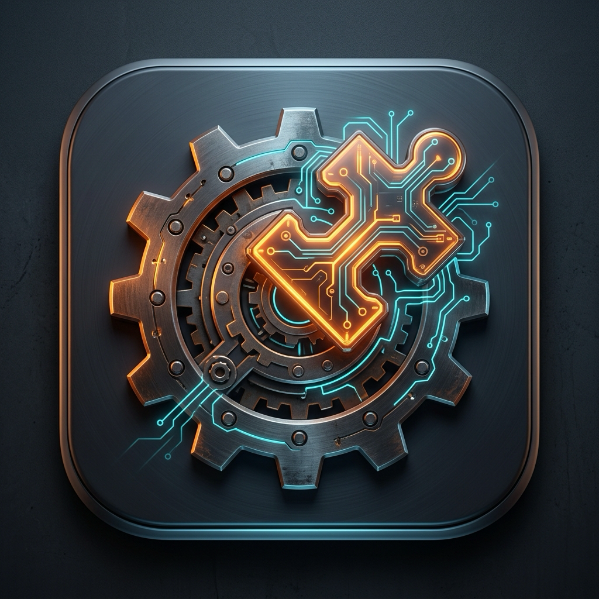
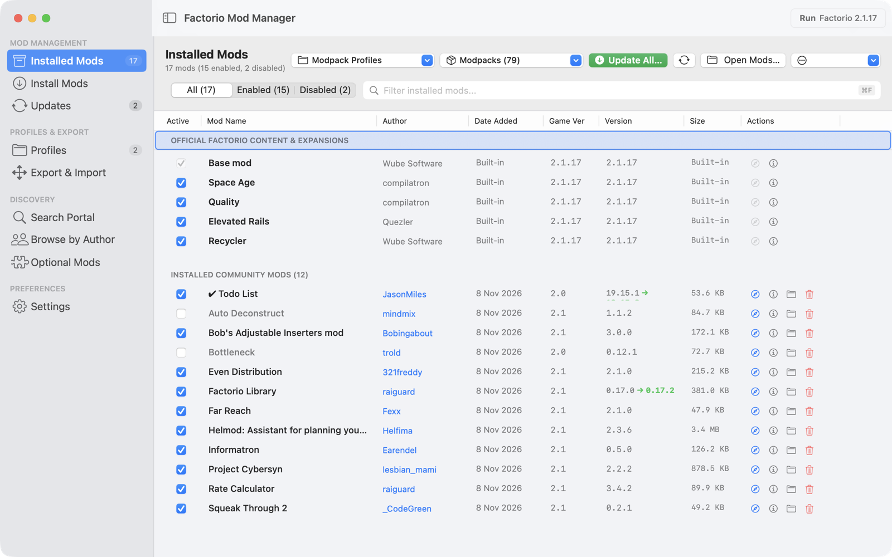
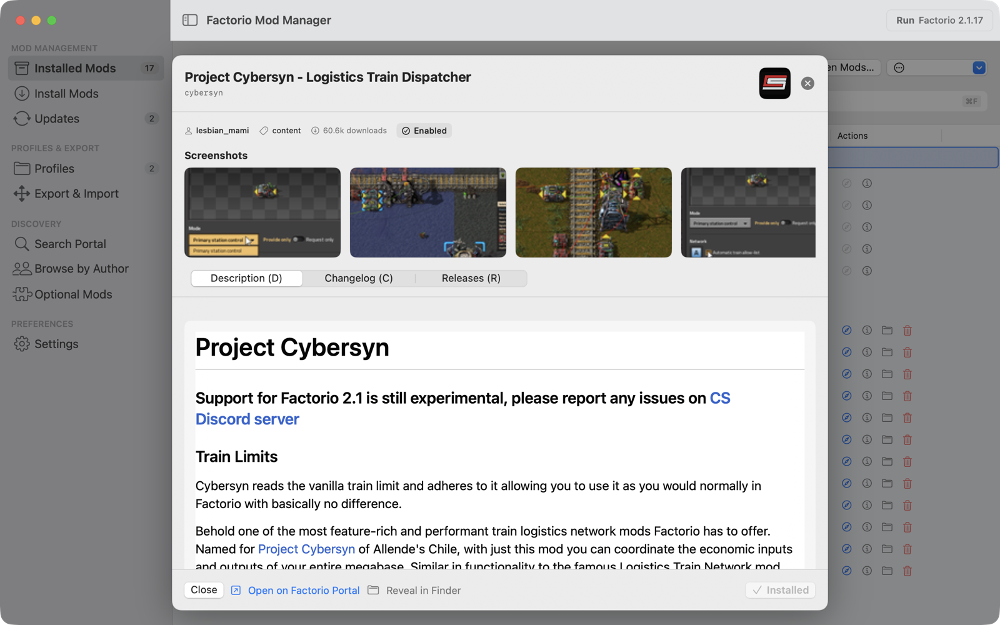
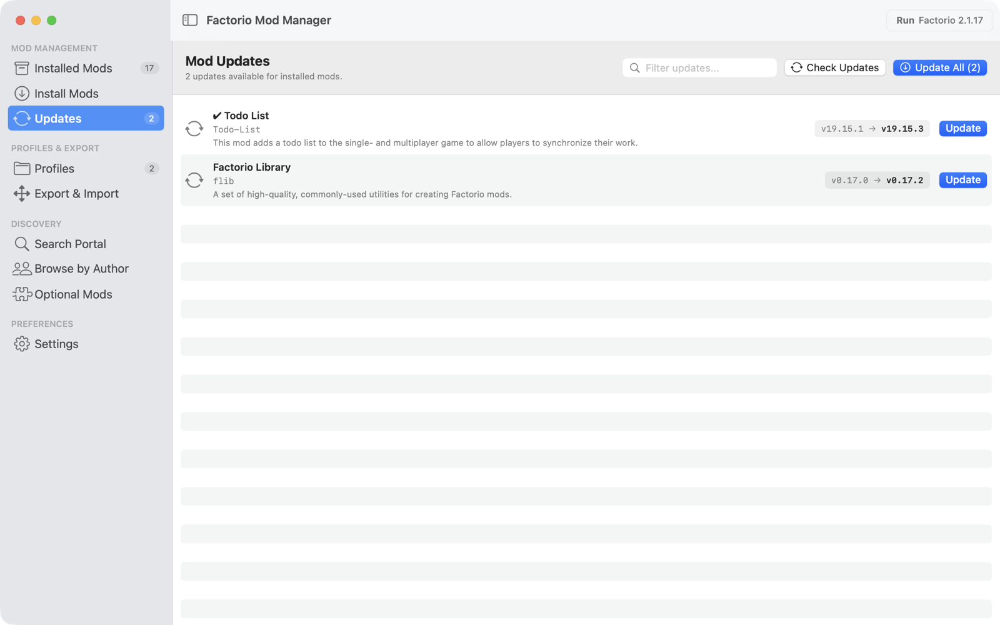
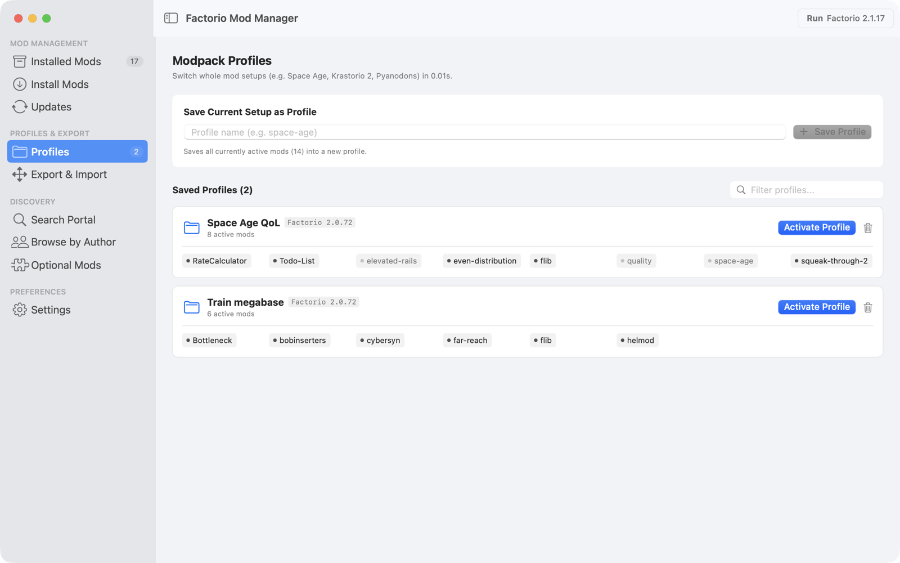
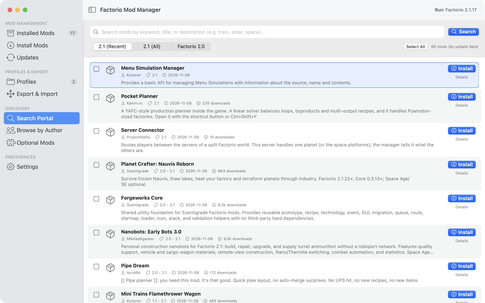

<p align="center"></p>

# Factorio Mod Manager for macOS

**English** · [Русский](README.ru.md)

[](https://github.com/Christian-SC26/factorio-mod-manager/releases/latest)
[](https://github.com/Christian-SC26/factorio-mod-manager/actions/workflows/release.yml)
[](#install)
[](#install)
[](LICENSE)

A native macOS app that installs Factorio mods with all their dependencies, needs no factorio.com login, and switches between mod sets in one click.



**Status:** actively developed by a single maintainer. CI runs the full test suite before it builds a release, and a single failing test stops the release.

## Why FMM

The in-game mod manager also installs dependencies, but it needs a factorio.com account and only works inside the game. FMM works outside it:

- **No login.** Downloads come from the community mirror [re146.dev](https://re146.dev).
- **Dependencies before download.** FMM resolves required, recommended (`+`) and optional (`?`) dependencies and shows conflicts (`!`) before it fetches anything.
- **Whole lists at once.** Paste portal links, mod names, `name@1.2.3` or a modpack file, and FMM installs all of it in one pass.
- **Profiles.** Save the set of enabled mods as a profile. Switching profiles rewrites `mod-list.json` and downloads nothing again.

**Pick another tool** if you run Windows or Linux, or need downloads from the official portal only. A third party runs the mirror: when it is down, FMM cannot download mods.

## Install

1. Download the archive for your Mac from the [latest release](https://github.com/Christian-SC26/factorio-mod-manager/releases/latest): `FMM-macOS-AppleSilicon.zip` for M-series chips, `FMM-macOS-Intel.zip` for Intel. Both run on macOS 13 or later, and on macOS 26 or later they use the Liquid Glass design.
2. Unzip it and drag `FMM.app` into Applications.
3. Open it. The release build is signed with an Apple Developer ID certificate and notarized by Apple, so macOS opens it without warnings. Apple scanned this exact build for malware, and the notarization ticket is stapled to the app, so the check works offline too.

   To verify a downloaded copy yourself:

   ```bash
   spctl -a -v /Applications/FMM.app
   ```

   The output should contain `accepted` and `source=Notarized Developer ID`.

FMM looks for mods in `~/Library/Application Support/factorio/mods`. You can pick another folder in the app's settings.

## Features

- Installed mods table: enable, disable, delete, filter by author.
- Search the mod portal and author pages, install several mods at once.
- Mod page with description, changelog and screenshots.
- Suggestions for optional add-ons to the mods you have.
- Update check across all installed mods.
- Updates itself: Settings → About finds a new release, checks its signature and relaunches into it.
- Modpack export and import as JSON or as a text file of links.
- Release selection for your game version (2.1, 2.0 or 1.1), detected from the Factorio log.
- English and Russian interface.

| Mod page | Updates |
|---|---|
|  |  |
| **Profiles** | **Portal search** |
|  |  |

## Keyboard shortcuts

Shortcuts follow physical key positions, so they work on non-Latin layouts too.

| Keys | Action |
|---|---|
| `⌘R` | Launch Factorio (from Applications or your Steam library) |
| `⌘N` | Install mods by link or name |
| `⌘U` | Check for updates |
| `⌘F` | Search |
| `↓` `↑` or `J` `K` | Move through the list |
| `Space` | Enable or disable the selected mods |
| `⌘I` | Mod info and dependencies |
| `⌘/` | All shortcuts |

## Build from source

You need macOS 13 or later, the Xcode command line tools (`xcode-select --install`) and an internet connection to fetch the [swift-markdown-ui](https://github.com/gonzalezreal/swift-markdown-ui) package.

```bash
git clone https://github.com/Christian-SC26/factorio-mod-manager.git
cd factorio-mod-manager/FactorioModManagerMac
./build_app.sh
open FMM.app
```

The script builds for your Mac's own architecture; set `FMM_ARCH=arm64` or `FMM_ARCH=x86_64` to build for the other one. A build from source is signed ad-hoc and not notarized; macOS trusts it on the Mac that built it. To sign and notarize with your own Apple Developer account, set `FMM_SIGN_IDENTITY` to your Developer ID Application identity and `FMM_NOTARY_PROFILE` to a `notarytool` keychain profile. Run the tests with `swift test`.

## License

[MIT](LICENSE).
