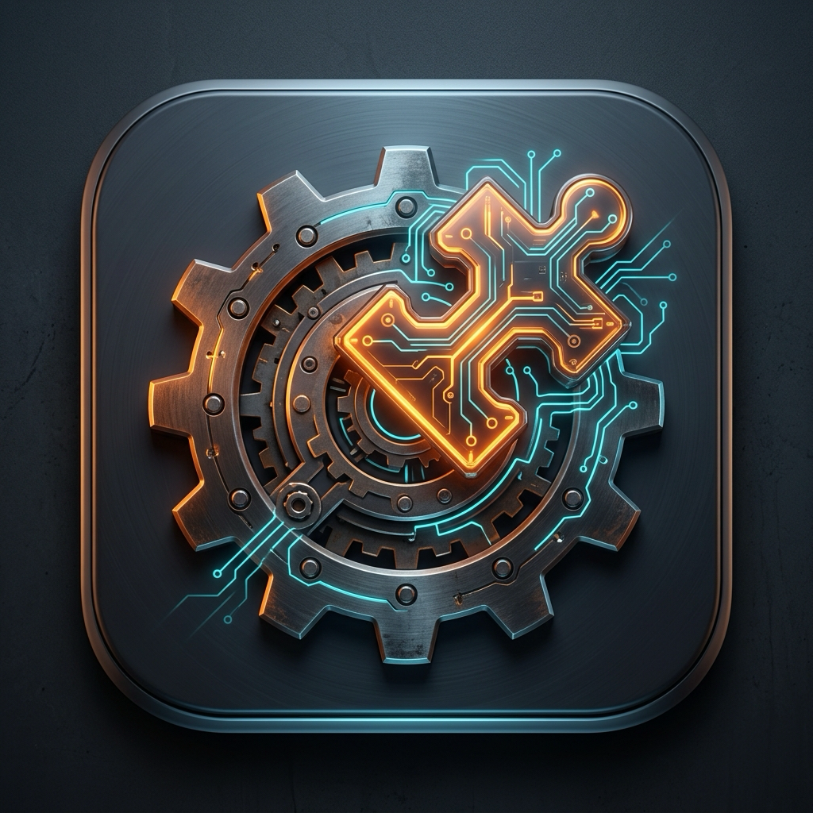
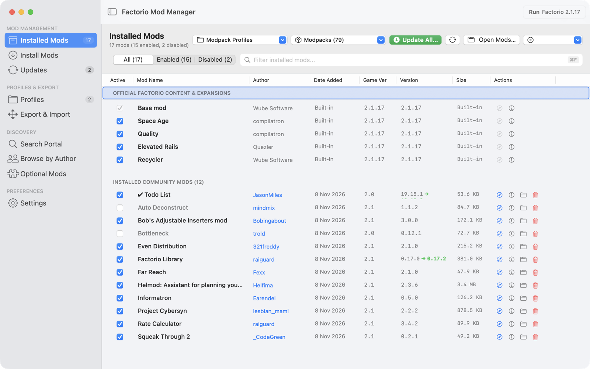
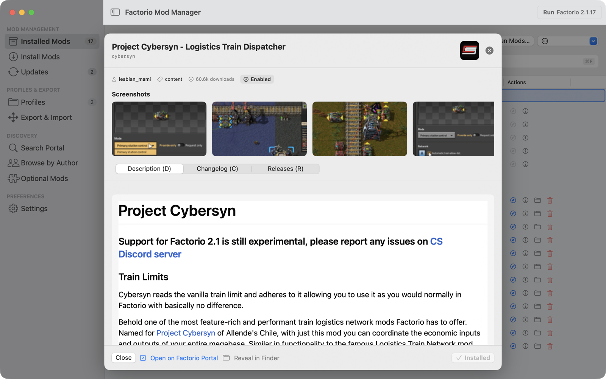
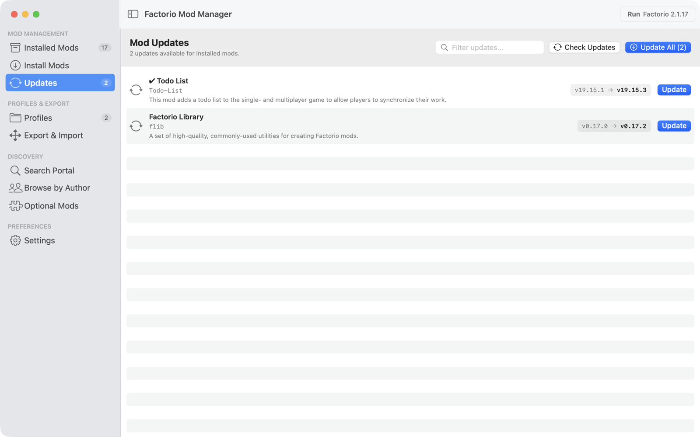
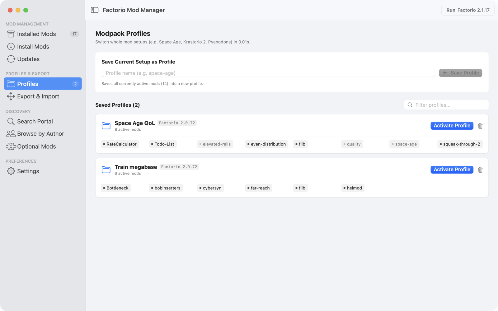
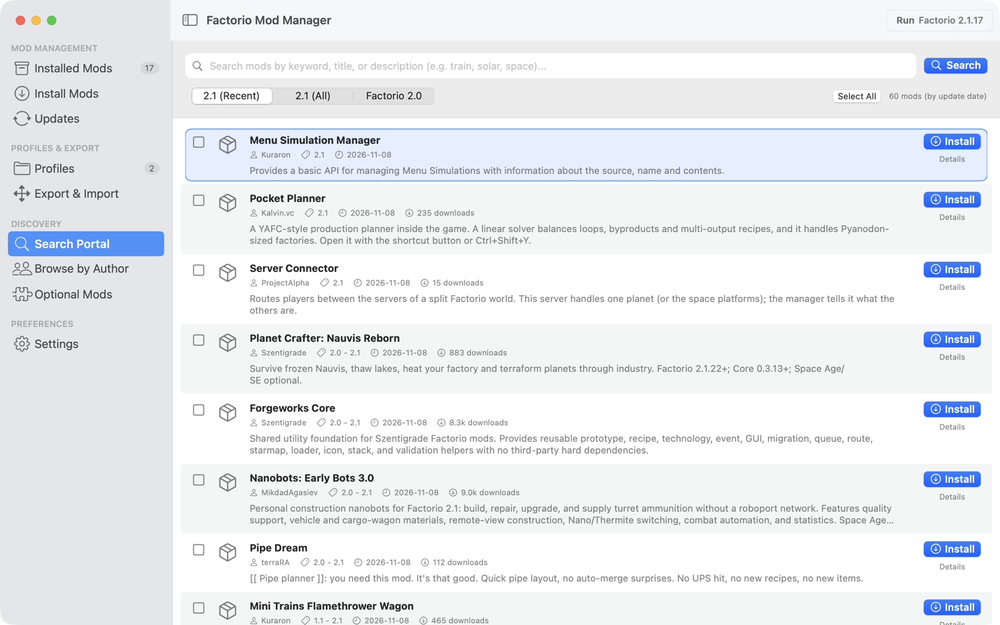

<p align="center"></p>

# Factorio Mod Manager для macOS

[English](README.md) · **Русский**

[](https://github.com/Christian-SC26/factorio-mod-manager/releases/latest)
[](https://github.com/Christian-SC26/factorio-mod-manager/actions/workflows/release.yml)
[](#установка)
[](LICENSE)

Нативное приложение для macOS, которое ставит моды Factorio вместе со всеми зависимостями без входа в аккаунт factorio.com и переключает наборы модов в один клик.



**Статус:** проект развивается, у него один разработчик. Перед каждой сборкой релиза CI прогоняет весь набор автотестов; если хоть один тест красный, релиз не выходит.

## Зачем FMM

Встроенный менеджер модов в игре тоже ставит зависимости, но требует аккаунт factorio.com и работает только внутри игры. FMM работает снаружи:

- **Без логина.** Моды скачиваются с общественного зеркала [re146.dev](https://re146.dev).
- **Зависимости до скачивания.** FMM строит граф обязательных, рекомендуемых (`+`) и опциональных (`?`) зависимостей и показывает конфликты (`!`) до того, как что-то скачает.
- **Список целиком.** Вставьте ссылки с портала, имена, `имя@1.2.3` или файл модпака, и FMM поставит всё за один раз.
- **Профили.** Набор включённых модов сохраняется как профиль. Переключение профиля переписывает `mod-list.json` и ничего не скачивает заново.

**Возьмите другой инструмент**, если у вас Windows или Linux или вам нужны загрузки только с официального портала. Зеркало принадлежит третьей стороне: когда оно недоступно, FMM не может скачивать моды.

## Установка

1. Скачайте `FMM-macOS.zip` со страницы [последнего релиза](https://github.com/Christian-SC26/factorio-mod-manager/releases/latest). Одно универсальное приложение работает на Mac с Apple Silicon и Intel под macOS 13 или новее.
2. Распакуйте архив и перетащите `FMM.app` в папку «Программы».
3. Запустите его. Приложение подписано сертификатом Developer ID и нотаризовано Apple, поэтому macOS открывает его без предупреждений.

FMM ищет моды в `~/Library/Application Support/factorio/mods`. Другую папку можно выбрать в настройках приложения.

## Возможности

- Таблица установленных модов: включение, выключение, удаление, фильтр по автору.
- Поиск по порталу и по страницам авторов, установка нескольких модов сразу.
- Карточка мода с описанием, историей изменений и скриншотами.
- Подсказки опциональных дополнений к уже установленным модам.
- Проверка обновлений для всех установленных модов.
- Экспорт и импорт модпака: JSON или текстовый файл со ссылками.
- Выбор релиза под вашу версию игры (2.1, 2.0 или 1.1); версию FMM определяет по логу Factorio.
- Интерфейс на русском и английском.

| Карточка мода | Обновления |
|---|---|
|  |  |
| **Профили** | **Поиск по порталу** |
|  |  |

## Горячие клавиши

Клавиши привязаны к физическим кнопкам, поэтому работают и в русской раскладке.

| Клавиши | Действие |
|---|---|
| `⌘R` | Запустить Factorio (из «Программ» или из библиотеки Steam) |
| `⌘N` | Установить моды по ссылке или имени |
| `⌘U` | Проверить обновления |
| `⌘F` | Поиск |
| `↓` `↑` или `J` `K` | Перемещение по списку |
| `Space` | Включить или выключить выбранные моды |
| `⌘I` | Информация о моде и его зависимостях |
| `⌘/` | Все горячие клавиши |

## Сборка из исходников

Нужны macOS 13 или новее, инструменты командной строки Xcode (`xcode-select --install`) и интернет, чтобы скачать зависимость [swift-markdown-ui](https://github.com/gonzalezreal/swift-markdown-ui).

```bash
git clone https://github.com/Christian-SC26/factorio-mod-manager.git
cd factorio-mod-manager/FactorioModManagerMac
./build_app.sh
open FMM.app
```

Если установлен полный Xcode, скрипт собирает универсальное приложение (Apple Silicon и Intel). С одними инструментами командной строки он собирает под архитектуру вашего Mac, и на Intel это тоже работает. Тесты запускаются командой `swift test`.

## Лицензия

[MIT](LICENSE).
